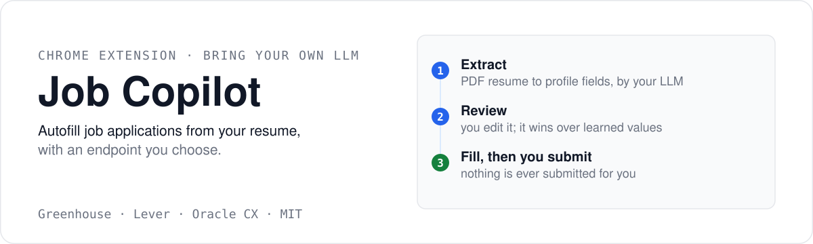
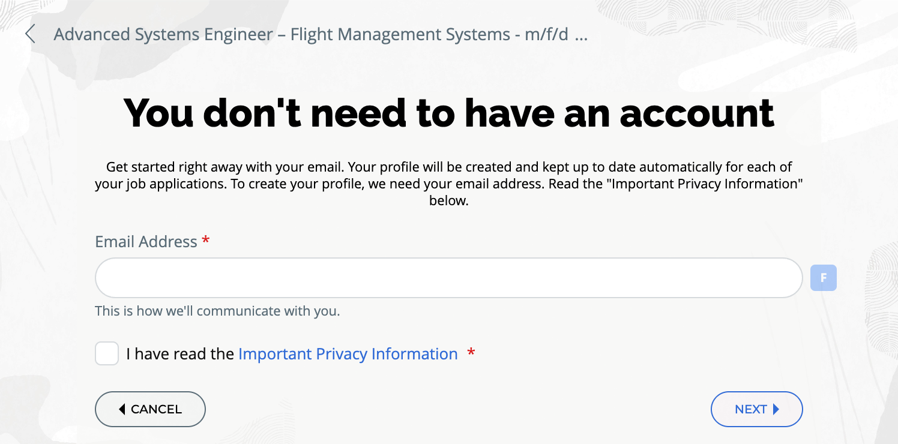
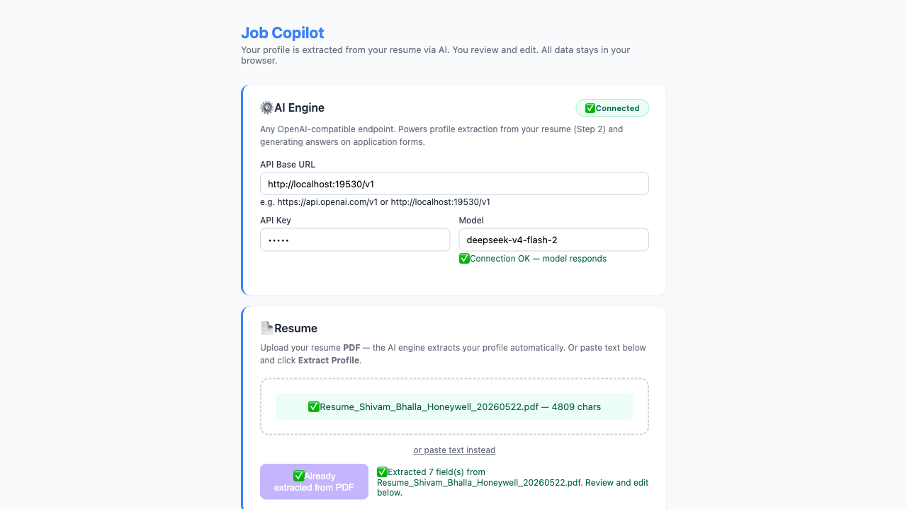

<p align="center">
  
</p>

**AI-powered job application autofiller.** Upload your resume once, review the extracted profile, and fill application forms on Greenhouse, Lever and Oracle CX — with any OpenAI-compatible endpoint you point it at.



*On a live Oracle CX application: detected fields get an **F** pill, and the floating **JC** button opens the panel.*

## How it works

1. **Extract.** Your resume PDF goes to your LLM, which proposes profile values — name, email, phone, LinkedIn, GitHub, address, work authorization.
2. **Review.** You edit anything it got wrong. The reviewed profile becomes the source of truth, and it wins over values learned from earlier applications.
3. **Fill.** On a job page, **Fill All** fills profile-derived fields and generates answers for readable custom questions. Every value is yours to check, and you submit the application yourself.

## Features

- **Resume to profile extraction** — upload a PDF (or paste text), click Extract, and the LLM fills your profile.
- **Verified profile** — you review and edit before anything is used.
- **Bring your own LLM** — any OpenAI-compatible endpoint: OpenAI, llama.cpp, Ollama, vLLM, Nyro.
- **Saved Q&A bank** — generated answers auto-save and are reused across applications.
- **Targets the big ATSes** — Greenhouse, Lever and Oracle CX verified live. Workday and iCIMS flows are implemented but unverified (Workday is account-gated).
- **Nothing is submitted automatically, ever.**
- **Private by construction** — data stays in browser storage; the only outbound request is to your LLM endpoint.
- **MIT licensed.**

## Install

1. Open Chrome → `chrome://extensions`
2. Enable **Developer mode** (top right)
3. Click **Load unpacked** → select the `extension/` folder
4. Pin the extension from the puzzle icon in the toolbar

## Setup



### 1. Connect your LLM

| Setting | Example (local Nyro gateway) | OpenAI |
|---------|------------------------------|--------|
| API Base URL | `http://localhost:19530/v1` | `https://api.openai.com/v1` |
| API Key | `dummy` (the local gateway ignores it) | `sk-...` |
| Model | *pick one from `${base_url}/models`* | `gpt-4o-mini` |
| Extra Headers (JSON) | `{"x-opencode-session":"pi-local"}` | *(clear it)* |

There is **no hardcoded default model**. The extension asks your endpoint for `${base_url}/models` and you pick from that list — a model name the endpoint does not serve returns HTTP 404. Use **Test connection** to confirm base URL, key and model before filling a form.

The local Nyro gateway rotates its model list, so re-open Settings and pick from the freshly fetched list rather than typing an old name.

**Extra headers** are sent with every LLM request. `{"x-opencode-session":"pi-local"}` is required by the local Nyro gateway (it rejects requests without it) and is harmless elsewhere. An explicit `Content-Type` or `Authorization` set here wins over the values derived from Base URL / API Key; strict endpoints may drop or reject unknown headers, so clear the field if your provider complains.

Requests retry a bounded number of times, and only on HTTP 502/503/504 or network errors. A 4xx (bad model, bad key) fails immediately instead of hammering the endpoint.

### 2. Extract your profile

Settings → upload your resume PDF (or **Paste resume text**) → **Extract Profile from Resume**. Then review every field: this profile is the source of truth for all fills.

## Usage

Open a job application. A floating **JC** button appears bottom-right; click it to show the control panel.

- **Fill All** fills the profile-derived fields.
- **F** pills fill one field.
- **✨** generates an AI answer for one question (resume + job description go to your LLM).

The extension refuses to fill a question it cannot read. A field with no readable question text is skipped and the status line reports `skipped (no question text)` rather than answering with invented text. Answers you generate land in **Saved Answers** for reuse.

Then review every value and submit the application yourself.

## Known limitations

- **The resume file itself is not attached** to `input type=file`. Only the extracted resume text is stored; the status line says so explicitly (`resume file not attached (no resume file stored — upload in Settings)`).
- **Workday is not exercised live** — its apply flow is account-gated, so it cannot be tested without a real candidate login.
- **Oracle CX support targets the real apply flow.** An expired or cancelled posting renders no application form, and the extension correctly fills nothing — it must not write profile data into job-search filter boxes.
- **A Lever fill takes ~35-36s**, above the 30s target, because of fixed waits in the education and language sections. Known perf item, not a correctness bug.
- **Lever's "Current location" auto-commit** works by re-asserting the value after the site's own widget rewrites it. If Lever changes that widget, this path needs re-verification.
- **LLM retries are bounded** to 502/503/504 and network errors. There is no retry on other failures and no request queue.

## Development

```bash
git clone https://github.com/shivam2014/job-copilot
cd job-copilot/extension
# edit, then reload the extension in chrome://extensions
```

```bash
npm test              # vitest — fast, matching-priority checks
npm run test:offline  # node test/run_all.mjs — full offline regression suite
npm run test:all      # both, in order
```

`npm test` alone is **not sufficient** — it covers the vitest spec only. Real regression coverage for extraction, form detection, fill mapping, the LLM bridge and prompt handling lives in `test/run_all.mjs`, so run `npm run test:offline` (or `test:all`) before committing.

### Architecture

Interactive diagrams covering the extension internals — file structure, the Fill All trace, the 7 clear phases, and resume data flow:

**[View interactive architecture](https://shivam2014.github.io/job-copilot/)** · or open `ARCHITECTURE_VISUAL.html` locally.

## Privacy

- API key and resume live in `chrome.storage.sync`, encrypted by Chrome.
- Nothing is sent anywhere except your configured LLM endpoint.
- No analytics, no tracking, no third-party services.

## License

MIT
